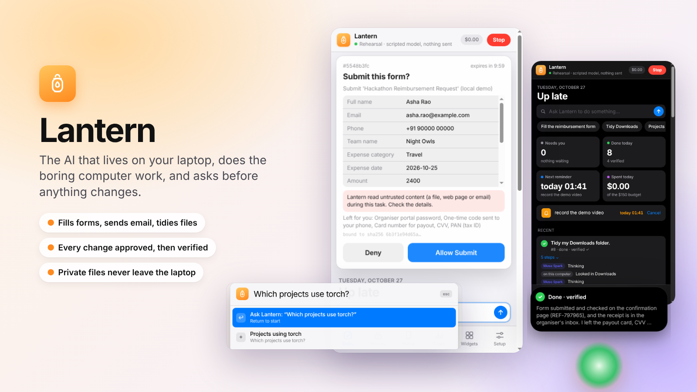
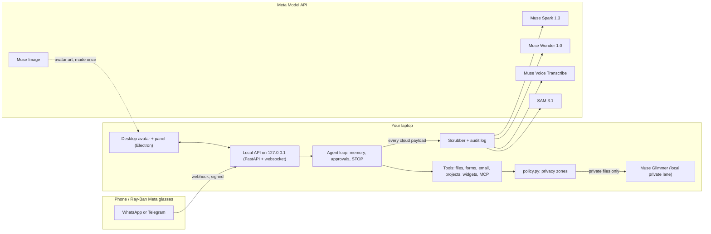
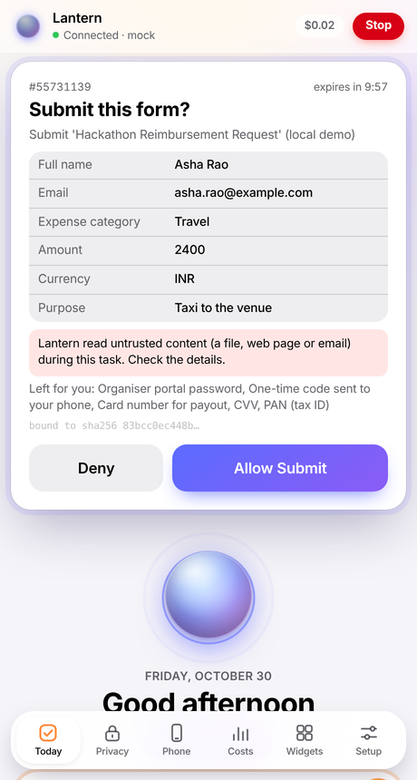
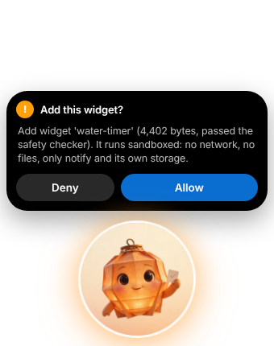
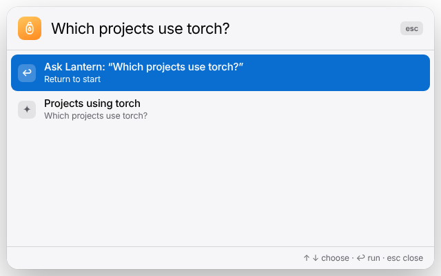
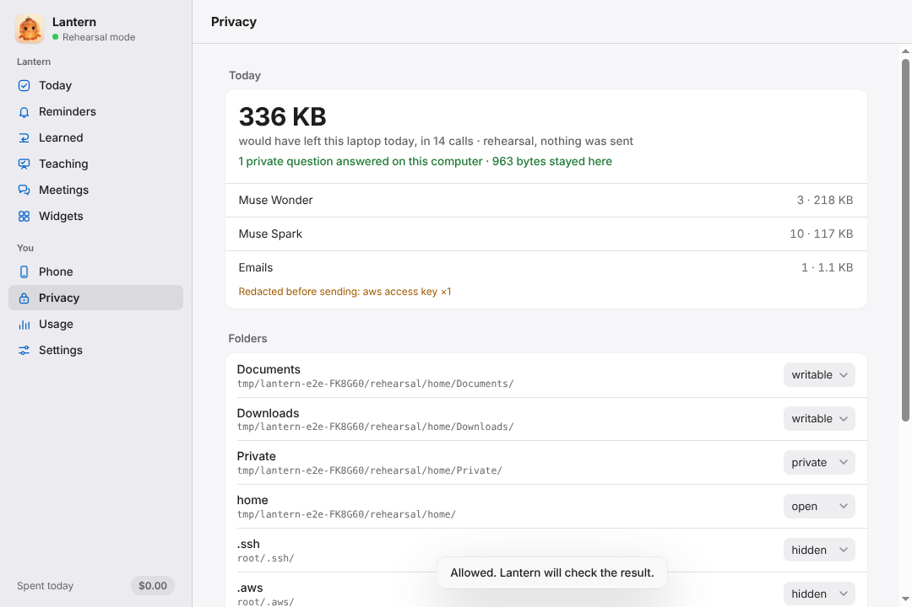
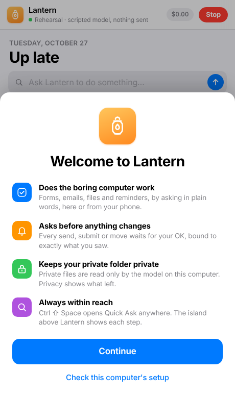
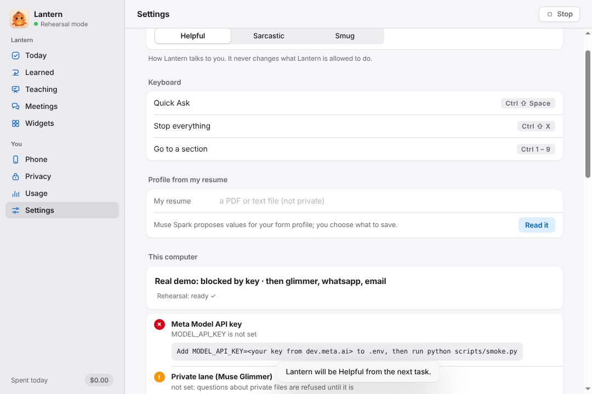

# 🏮 Lantern



**I hate forms. Lantern is an AI that lives on my laptop, does the boring computer work for me (forms, email, files), asks before anything leaves the machine, and never reads my private folder in the cloud.**

Built on Meta's Muse models for the Meta Global AI Developer Hackathon (Oct 26 – Nov 4, 2026).

## Try it in 5 commands

```bash
git clone https://github.com/guthib241/lantern && cd lantern
pip install -e . && python -m playwright install chromium   # gives you the `lantern` command
lantern --demo-run                                 # the whole 3-minute story, offline, no key, $0
echo "MODEL_API_KEY=your-key-from-dev.meta.ai" > .env && python scripts/smoke.py
cd desktop && npm install && npm start             # the desktop app; it starts the Lantern server too
```

On Windows (PowerShell 5.1 has no `&&`; `py -m lantern` works even when pip's Scripts folder isn't on PATH):

```powershell
git clone https://github.com/guthib241/lantern; cd lantern
py -m pip install -e .; py -m playwright install chromium
py -m lantern --demo-run
Set-Content .env "MODEL_API_KEY=your-key-from-dev.meta.ai"; py scripts\smoke.py
cd desktop; npm install; npm start                 # the desktop app; it starts the Lantern server too
```

A `.env` saved by `echo … > .env` (UTF-16 in PowerShell 5.1) or by Notepad with a BOM loads fine too.

`--demo-run` is a rehearsal. A scripted stand-in plays Muse Spark and Muse Wonder (zero tokens). Everything else runs for real on a fresh copy of [`demo/home/`](demo/home):
- the privacy zones, scrubber and audit log
- approvals tapped on a simulated phone
- a real Chromium filling [`demo/forms/`](demo/forms)
- the email outbox, the project map, the widget checker and every verification

Use `npm run rehearsal` (in `desktop/`) to click through the same story in the desktop app; it starts `lantern --serve --demo` for you and stops it when you quit. If a server is already running (`lantern --serve` in a terminal), the app uses that one instead. `python -m lantern --doctor` tells you what this laptop still needs for the real thing, with the exact fix for each item.

## The demo (3 minutes)

| Time | What you see | What's underneath |
|---|---|---|
| 0:00 | "I hate forms. My AI lives on my laptop and never reads my private folder." The avatar wakes up. | Electron overlay; faces made with Muse Image |
| 0:15 | Walking, Ray-Ban Meta glasses: *"send a voice message to Lantern: fill the hackathon reimbursement form and email it to the organiser"* | WhatsApp voice note → ffmpeg → **Muse Voice Transcribe** |
| 0:50 | The laptop fills the form live (badge **Muse Wonder**). It leaves the password, OTP, card, CVV and PAN fields alone. Submit pauses, WhatsApp shows **Approve / Deny**, tap Approve, and Lantern verifies the confirmation page and emails the receipt. | Playwright + computer use, approval bound to a hash of every value, IMAP check of Sent |
| 1:40 | "What base salary does the offer letter in my Private folder say?" The badge reads **Muse Glimmer (local)**. The audit shows 0 bytes of the letter left. A planted fake key in my notes is redacted before the cloud call. | Privacy zones, private lane, scrubber, audit log |
| 2:20 | "Which projects use torch?" (no model call) · "make me a water timer". The widget appears and the avatar teases. | Environment map; widget written by **Muse Spark**, checked, sandboxed |
| 2:45 | Architecture + Meta model map. "Ready for Meta AI Connectors": Lantern is also an MCP server. | |

## How it fits together



## Meta model map

| Model | ID | What Lantern uses it for |
|---|---|---|
| Muse Spark 1.3 | `muse-spark-1.3` | The agent: planning, tool calls, the form planner, writing widgets, tool search over MCP tools |
| Muse Wonder 1.0 | `muse-wonder-1.0` | Computer use: looking at the browser and clicking through custom dropdowns and date pickers |
| Muse Glimmer | `muse-glimmer` (local) or `meta-models/muse-spark-open-1026` (Baseten) | The private lane: questions about files in private zones, answered on your own hardware |
| Muse Voice Transcribe 1.0 | `muse-voice-transcribe-1.0` | WhatsApp voice notes from your phone or glasses |
| Muse Image 1.0 | `muse-image-1.0` | Lantern's face: a canonical portrait plus six anchored expressions |
| SAM 3.1 | `sam-3.1` | Optional camera check-in ("is my coffee mug there?"); objects only, never people |

All IDs live in [`lantern/models.py`](lantern/models.py). Lantern never uses `-contributor` models on your data. No other AI provider is used anywhere in the product.

## On your desktop

| Approve with the full picture | Live activity island | Quick Ask (Ctrl/Cmd+Shift+Space) |
|---|---|---|
|  |  |  |
| **What left my laptop** | **First launch** | **Setup check and preferences** |
|  |  |  |

*Screenshots of the real app (`lantern --serve --demo`), captured by the end-to-end test.*

- **Live activity island:** a black capsule above Lantern's face shows each step as it happens, and grows into a small card for approvals, results and reminders. Clean approvals can be answered right there. Anything that followed untrusted content (every form submit) asks you to **Review** the full sheet.
- **Quick Ask:** press **Ctrl/Cmd+Shift+Space** anywhere, type, press Return. ↑/↓ for suggestions and recent tasks; "stop" stops everything.
- **Menu bar and notifications:** the lantern icon in the menu bar (system tray on Windows/Linux) shows what Lantern is doing and how many approvals wait. System notifications cover approvals (title only, never the values), reminders and failures.
- **The panel:**
  - a Today view with at-a-glance tiles and suggestions
  - approval sheets that show form fields as a table
  - Privacy (what left the laptop, zones, forget), the simulated phone, costs, widgets, and the Setup check
  - light and dark mode; Ctrl/Cmd+1…6 switch tabs

## Safety model (enforced in code, not in prompts)

- **Privacy zones** (`~/.lantern/zones.json`):
  - `hidden`: never even listed.
  - `private`: read only by the local model; the cloud gets its scrubbed answer, never the file.
  - `open`: readable, scrubbed on the way out.
  - `writable`: Lantern may create or move files here, after your approval.
- **Everything that leaves is scrubbed and logged.** Keys, tokens, card, Aadhaar and PAN numbers are scrubbed out of every cloud payload, tool results included. Each payload is logged with its SHA-256. The panel's "What left my laptop today" reads that log.
- **Approvals** are single-use, expire in 10 minutes and are bound to a hash of the exact payload. If anything changes after you say yes (a field, an attachment), Lantern refuses and asks again.
- **Hard stops:** Lantern never types into password, OTP, card, CVV, PIN or government-ID fields, and stops at CAPTCHAs ("you do this part").
- **Untrusted content:** anything read from files, web pages, emails or MCP is wrapped as untrusted data. Once it's in context, every risky tool needs approval, and instructions inside it are ignored.
- **The model that acts never reads the content** (with `lantern --serve`; after the published CaMeL and FIDES designs, arxiv.org/abs/2503.18813 and arxiv.org/abs/2505.23643):
  - **Handles, not text.** A file's text, a page, an email or another program's result reaches the planner as a handle like `$doc1`. To learn something from it, the planner asks the **Reader**: a separate call with no tools whose answer must fit a type (yes/no, one of given options, a number, a date). A text answer becomes another handle the planner can pass on but can't read. The Reader also says whether the content tried to give instructions, and Lantern checks for that in code too.
  - **Labels on values.** Every handle carries where it came from (trusted or untrusted) and how private it is (public, private or secret). A recipient, web address, command or tool input that came from content shows on a red card as "came from a file, not from you: approve only if you meant it"; a form at such an address needs its own yes before the browser even opens it.
  - **Private stays here.** An answer from your Private folder is a private handle: it's filled in on your own screen only, your phone gets "‹private: shown on your computer›" instead, it can't go into memory, and the audited client refuses any cloud request that would carry it ("Nothing was sent").
  - **Risk tiers on every tool:** green (reads, no card), yellow (reversible local changes, one tap), red (send, submit, run, share: the full card bound to the payload hash, never one tap).
  - **Learned routines are fixed plans** with every target cross-checked in the page: injection-resistant by construction, with branch-steering checks. Not injection-proof: a typed answer (a number, a choice) read from content can still be wrong on purpose, which is why it shows on the card before anything uses it.
  - **Tested** on the attack pack in [`demo/attacks/`](demo/attacks) (hidden text, fake SYSTEM banners, zero-width tricks, planted secrets, a spoofed email, a poisoned search result, the portal in attack mode), with honest, compromised-planner and compromised-reader scripts: `tests/test_injection.py`.
  - **Measured, not claimed:** `python scripts/eval_privacy.py --runs 5` runs the portal tasks with raw and masked screenshots (`LANTERN_SCREENSHOTS=masked` puts black boxes over your own values before a screenshot leaves) and reports success, steps, cost, what showed in screenshots, any private value found in any request that left, and whether every payload is in the audit log. Its numbers go here once it has been run with the real models.
- **Verified, or it says so:** every action checks its result on disk or via the API and reports `verified: true/false`.
- **A receipt for every task:** tap **Receipt** on a task (or send "receipt" from your phone, or `lantern --receipt 12`). It shows what changed and whether each change was checked, what you approved (and the payload hash it was bound to), every byte that left and where it went, what was redacted, what stayed on the local lane, and the cost. It's built from Lantern's own logs, never written by a model.
- **Other rules:** Lantern never deletes. The server listens on 127.0.0.1 only, with a token. **STOP** (button, Ctrl/Cmd+Shift+X, or the word STOP on WhatsApp) cancels everything.
- **Encrypted memory, real forgetting:** memory and the audit log are encrypted on disk with a key in your OS keychain. "Forget" overwrites the rows and rebuilds the database file.

## Reliability

Lantern retries only what's temporary:
- **Retried:** 429, 5xx, timeouts and dropped connections, with exponential backoff, jitter and `Retry-After`. The avatar says "the network's wobbly".
- **Not retried:** 400, 401 and 404, which fail fast with a sentence you can act on ("check MODEL_API_KEY", "you're offline").
- **Circuit breaker:** after repeated failures, Lantern pauses calls for 30 seconds.
- **Spending limits, in code:** before every model call Lantern checks what it has spent. The defaults are **$150 total** (`LANTERN_BUDGET_USD`) and **$3 per task** (`LANTERN_TASK_BUDGET_USD`); a daily limit (`LANTERN_DAILY_BUDGET_USD`) is optional. A call over a limit never leaves the laptop and isn't retried, and the task stops with the reason and the variable to raise. Past 80% of the total, Lantern warns you once. The Costs tab shows the limits; forgetting tasks doesn't reset the count.

Failed tasks have a **Try again** button. Timeouts are set by `LANTERN_TIMEOUT` (seconds, default 120).

## Your phone: WhatsApp (and Telegram)

**Scope:** Lantern's WhatsApp number is a **personal task and approval console for your own computer, not a general chatbot**, following WhatsApp's January 2026 rule on AI providers. It only listens to your number. It takes tasks, voice notes, approvals (Approve / Deny / Show buttons), `status` and **STOP**.

Setup (once):
1. developers.facebook.com → create an app → add **WhatsApp** → note the test number's **Phone number ID** and add your own number as a recipient.
2. Business settings → System users → create one, give it the app with `whatsapp_business_messaging`, and generate a **permanent token** (not the 24-hour one). App settings → Basic → **App secret**.
3. In `.env`, set:
   - `LANTERN_CHANNELS=whatsapp`
   - `WHATSAPP_TOKEN`
   - `WHATSAPP_PHONE_NUMBER_ID`
   - `WHATSAPP_APP_SECRET`
   - `WHATSAPP_VERIFY_TOKEN` (any random string)
   - `LANTERN_WHATSAPP_OWNER` (your number, digits only, with country code)
4. `python -m lantern --serve`, then `cloudflared tunnel --url http://127.0.0.1:8765`.
5. In the app's WhatsApp → Configuration, set the callback URL `https://<tunnel>/webhook/whatsapp`, enter the same verify token, and subscribe to **messages**.
6. Send "hi" to the test number (this opens WhatsApp's 24-hour window), then run `python -m lantern --channel-test "Lantern here"`.
7. Glasses: save the test number as a contact named "Lantern" and say "Hey Meta, send a voice message to Lantern on WhatsApp".

Telegram fallback: create a bot with @BotFather, then set `LANTERN_CHANNELS=telegram`, `TELEGRAM_BOT_TOKEN` and `LANTERN_TELEGRAM_OWNER` (your chat id).

## Everyday use

```bash
python -m lantern                                     # chat in the terminal
python -m lantern "find my march invoice and move it to Documents/Tax"
python -m lantern --profile-set "full name" "Asha Rao"  # the local profile vault for forms
python -m lantern --which torch                       # which projects use torch? (no model call)
python -m lantern --tasks | --task 3 | --usage | --audit | --zones
python -m lantern --resume                           # continue tasks cut short when Lantern last stopped
python -m lantern --forget-task 12 | --forget-everything
```

- **Forms:** Lantern uses its own Chromium profile with no saved passwords. Set `LANTERN_FORMS_MODEL=muse-wonder-1.0` for final runs and `LANTERN_FORMS_HEADLESS=0` to watch it work. `python scripts/smoke.py cua` checks computer use against the real API.
- **Email:** for Gmail, turn on 2-step verification and create an **app password**. Then set `LANTERN_EMAIL_MODE=smtp`, `LANTERN_SMTP_USER` and `LANTERN_SMTP_PASSWORD`. Lantern checks the Sent folder over IMAP before calling an email verified.
- **Private lane:** run Muse Glimmer locally (llama.cpp or any OpenAI-compatible server; step by step in [docs/GLIMMER.md](docs/GLIMMER.md)) and set `LANTERN_GLIMMER_URL=http://127.0.0.1:8080/v1`. Without it, Lantern refuses questions about private files (rehearsal mode uses a labelled offline stand-in). It never falls back to the cloud for private files.
- **Tidy a folder:** "tidy my Downloads". You get one approval card for the whole plan and every move is checked on disk. **Undo** (the button on the task, or "undo" typed or sent from your phone) puts everything back from Lantern's own move log: one card, no model call, never over a newer file.
- **Reminders:** "remind me at 6 pm to submit the video", or "every day at 9:00 standup". Your phone and the desktop get it on time. Reminders are plain timers that repeat your words.
- **Widgets:** "make me a water timer". Muse Spark writes it, a static checker rejects network or eval code, and it runs in a sandboxed frame. See [docs/WIDGETS.md](docs/WIDGETS.md).
- **MCP:**
  - `python -m lantern --mcp` exposes Lantern's read-only tools and `submit_task` to other AI apps (scrubbed, audited, approvals still yours).
  - Servers listed in `~/.lantern/mcp.json` become deferred tools that Muse Spark finds through tool search.
- **Lantern's face:**
  - `python scripts/make_avatar.py` uses Muse Image (about $0.07).
  - `python scripts/import_avatar.py ~/Downloads/muse/` imports art you made in the MetaMuse app or Vibes.
- **Camera check-in (SAM 3.1):** click 📷 in the panel. Lantern takes one snapshot, looks for objects only, and stores nothing.
- **Learned routines:** after a web form task or a tidy-up finishes and checks out, choose **Learn this** (or send "learn" from your phone). A tidy-up is learned as rules ("*.jpg → Images"), so next week's files are sorted too. Lantern turns it into a small checked program. The next time you ask, it runs with one approval and no model calls. If the site moves a field it heals itself; if the site adds a page, Lantern does the task step by step once and re-learns it. `python -m lantern --routines` lists them.
- **Photo of a paper (glasses or phone):** send it to Lantern on WhatsApp ("Hey Meta, send a photo to Lantern") with a caption or a voice note saying what it's for. SAM 3.1 finds the page, Lantern straightens it into a clean PDF in `Scans`, Muse Spark reads it, and the learned routine runs with the scan attached once you approve on the phone.
- **Show Lantern once:** Costs → *Show Lantern once* in the panel, or `python -m lantern --teach http://127.0.0.1:8770/apply/personal "apply for a city permit"`. Lantern's browser opens; you fill the form yourself; press Done after its confirmation page. Lantern learns it like any other routine. What you typed stays on this computer (never a password's value), and no screenshot is sent anywhere.

## Cost so far

| | |
|---|---|
| API credit | $150 |
| Spent while building | $0.00: built and tested against scripted fakes (`tests/fakes.py`, the rehearsal model) |
| Spent testing on the live API (Oct 27) | **about $0.90** for every feature, several times over (see below) |

Measured on the live API, Muse Spark doing the planning:

| What | Time | Cost |
|---|---|---|
| Voice note → form filled with **Muse Wonder** → email sent, both verified | 135 s | $0.077 |
| The same with Spark doing the clicking | 111 s | $0.066 |
| Question about a private file (answered on the private lane) | 50–77 s | $0.02–0.03 |
| "Which projects use torch?" | 21–27 s | $0.01–0.015 |
| "Make me a water timer" (widget written, checked, saved) | 40–44 s | $0.03 |
| Tidy Downloads (6 files, one approval) / Undo | 68–98 s / instant | $0.02–0.03 / $0 |
| Prompt-injection file summarised, injection ignored | 39 s | $0.014 |
| Lantern's face: 7 expressions with Muse Image | 2 min | $0.07 |
| SAM 3.1 check-in, one snapshot | 1 s | $0.0025 |

A full rehearsal of the story on the live API costs about **$0.25**, so recording-day retakes are cheap.
Lantern logs tokens and cost per task (`python -m lantern --usage`, the panel's Costs tab), and the spending limits keep a runaway loop from eating the credit (checked live: a $0.002 task limit stopped the task after one call).

## Tests

```bash
pip install -e ".[dev]"
python -m pytest -q          # ~570 tests, offline: fake model, real Chromium on demo/forms and demo/portal, real uvicorn
python -m pyflakes lantern scripts tests
cd desktop && npm test       # the panel's logic and the mock server on their own
cd desktop && npm install && npm run e2e   # the real Electron app against the real server, whole story (Linux without a screen: xvfb-run -a npm run e2e)
```

GitHub Actions runs the lint, every test, the full offline rehearsal and the doctor on each pull request (`.github/workflows/ci.yml`). `python -m lantern …` and `lantern …` are the same command.

## What you need to set up on your laptop

`python -m lantern --doctor` (or the panel's **Setup** tab) checks all of this and prints the fix for anything missing.

1. `MODEL_API_KEY` in `.env`, then `python scripts/smoke.py` and `python scripts/smoke.py cua`.
2. `python -m playwright install chromium` (once).
3. Muse Glimmer running locally, then `LANTERN_GLIMMER_URL`.
4. WhatsApp: the steps above, plus `cloudflared`.
5. Gmail app password: `LANTERN_EMAIL_MODE=smtp`, `LANTERN_SMTP_USER`, `LANTERN_SMTP_PASSWORD`.
6. `cd desktop && npm install && npm start`.
7. Lantern's face: `python scripts/make_avatar.py`, or import from MetaMuse.
8. Allow the OS keychain prompt the first time, which stores the memory key.

Submitting: [docs/SUBMISSION.md](docs/SUBMISSION.md) (video script, slide, write-up). More: [docs/SPEC.md](docs/SPEC.md) · [docs/DECISIONS.md](docs/DECISIONS.md) · [docs/THIRD_PARTY.md](docs/THIRD_PARTY.md) · [BUILD_LOG.md](BUILD_LOG.md) · [desktop/README.md](desktop/README.md)
